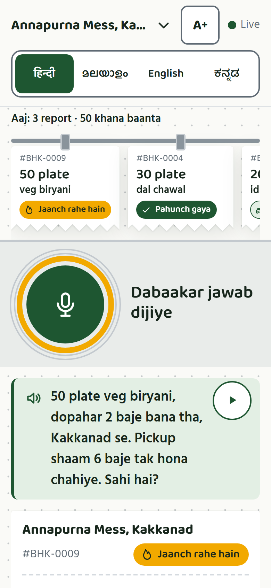
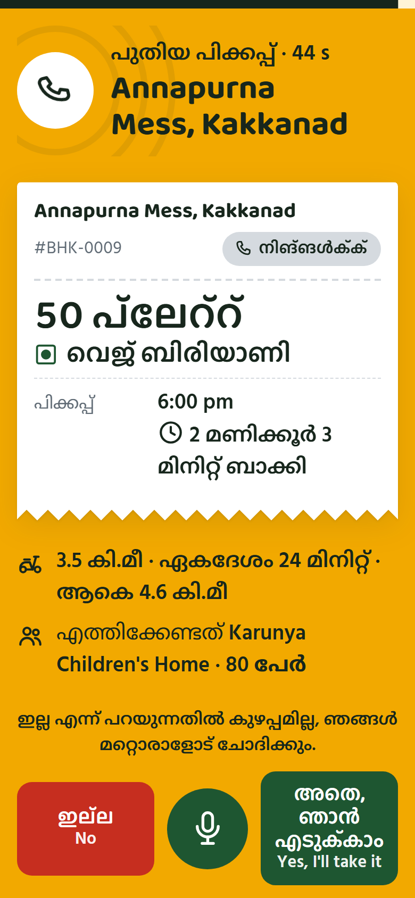
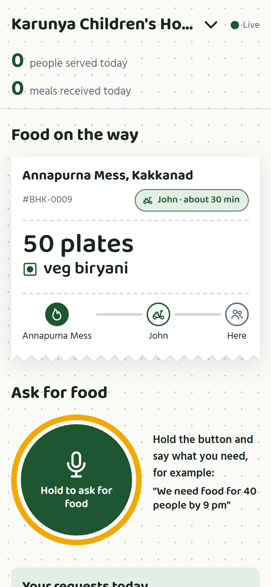
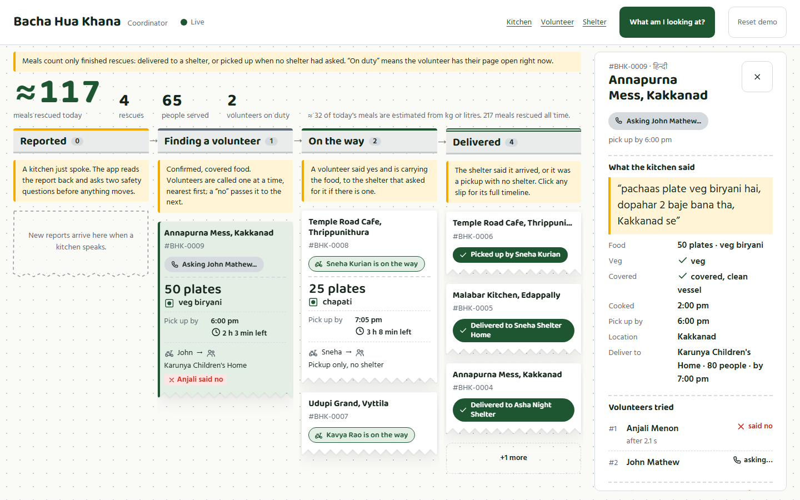
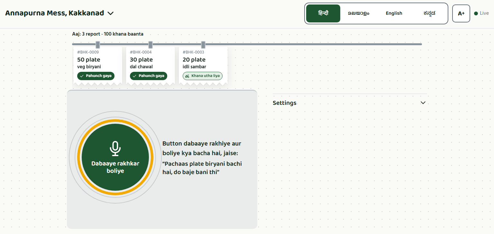
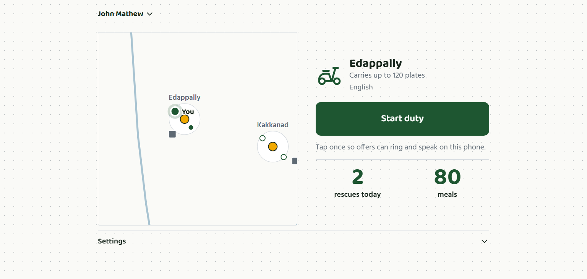
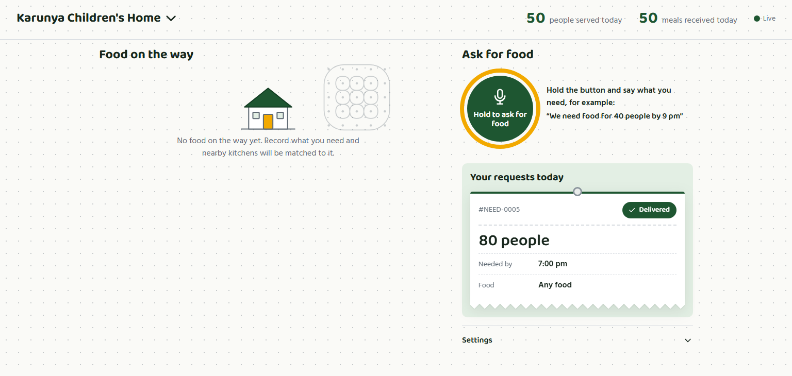
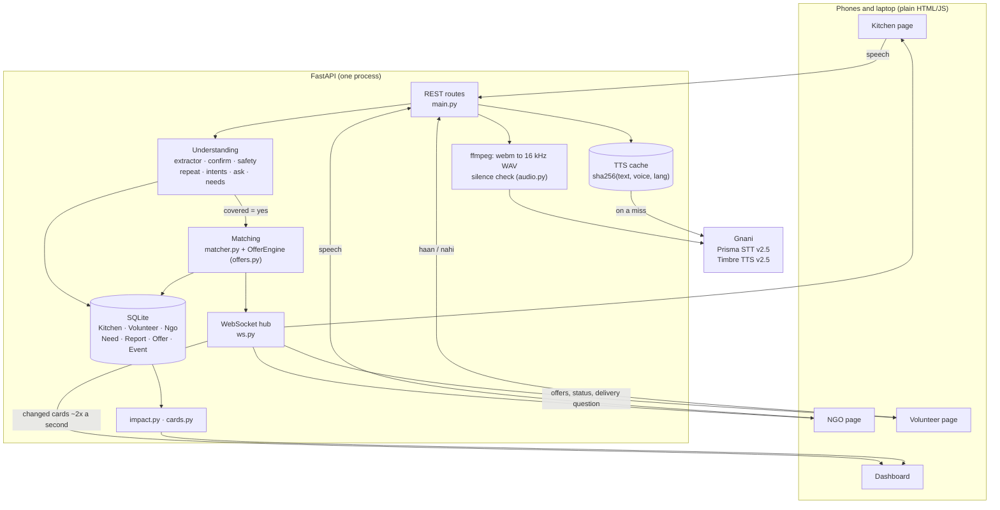
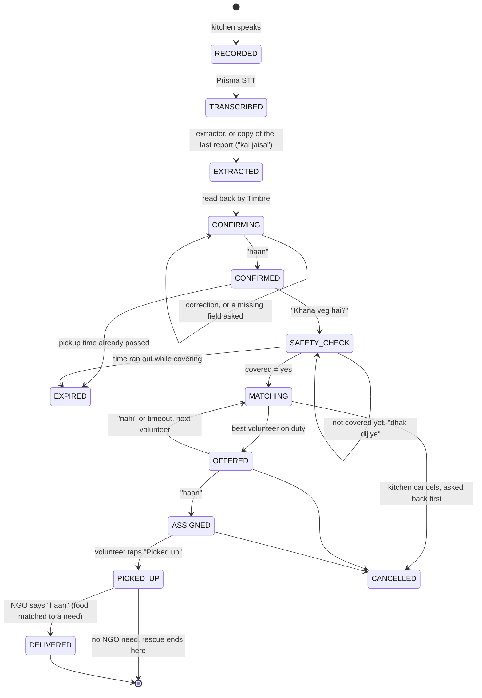

# Bacha Hua Khana

Voice-first surplus food rescue, built on Gnani's Prisma (speech-to-text) and
Timbre (text-to-speech) APIs. A kitchen says what food is left over. The app reads
it back and checks that the food is safe, all by voice. It then finds a shelter
that asked for food, also by voice, and calls the best volunteer in their own
language to carry it there.

kitchen (supply) → volunteer (courier) → NGO or shelter (demand)

This is a prototype for Gnani AI's Great Indian AI Internship Challenge. All
kitchens, volunteers, NGOs and phone numbers are synthetic, placed around Kochi.

## Screenshots

One mock run: Annapurna Mess reports 50 plates in Hinglish, Anjali (Malayalam) says no, John
(English) takes it to Karunya Children's Home. The full set, including the home page and both
impact-card sizes, is in [`docs/screenshots/`](docs/screenshots/).

| Kitchen reads it back | Volunteer gets the offer | Shelter sees it coming |
|---|---|---|
|  |  |  |



On a laptop each screen fits the window without scrolling:

| Kitchen | Volunteer, before going on duty | Shelter |
|---|---|---|
|  |  |  |

## Features

- **Report by voice:** *"pachaas plate veg biryani, do baje bana, Kakkanad se"* gives
  dish, quantity, unit, cooked time and place. A missing field gets a spoken follow-up
  question. Nothing happens on a guess: every report is read back, and staff confirm,
  say no, or correct one field (*"nahi, saath plate"*).
- **Food safety check:** before any matching, two quick questions: *"Khana veg hai?"*
  and *"Khana dhaka hua aur saaf bartan mein hai?"*. Uncovered food is never sent;
  the kitchen hears *"Kripya khana dhak dijiye, phir haan boliye"* until it says yes.
  Food past its pickup time is marked EXPIRED instead.
- **"Kal jaisa":** a canteen that reports daily says *"kal jaisa"*, *"innale pole"* or
  *"same as yesterday"*, optionally with changes (*"kal jaisa, bas 30 plate"*). The
  last report is copied, today's cooking time is asked, and everything is still read
  back. The kitchen page shows the last report so staff know what will be copied.
- **NGO needs by voice:** a shelter says *"aaj raat 80 logon ke liye khana chahiye"*
  and confirms it. Confirmed food goes to the nearest need it fits: veg rules, enough
  for at least half the people, and arriving in time.
- **Volunteer calls with fallback:** the soonest volunteer who can carry the food and
  make the deadline hears the offer in their language: where to collect and where to
  deliver. They answer haan / nahi. On "no" or silence the next one is asked.
- **Delivery confirmed by the NGO:** the volunteer taps *delivered*, and the NGO page
  asks *"Khana aa gaya?"* in the shelter's language. Its "haan" closes the rescue.
- **Kitchen questions:** after confirming, the kitchen asks *"volunteer kab aayega?"*
  and hears the live answer, for example *"John raaste mein hain. Pahunchne mein
  lagbhag 25 minute."* Saying *"cancel"* is asked back first; only a yes cancels.
- **Live dashboard, a route board:** each report is a KOT slip that slides from
  *Reported* to *Finding a volunteer*, *On the way* and *Delivered*, with a mirchi mark
  for every volunteer who said no. Click a slip for its full timeline: the kitchen's
  words in its own script, the fields, safety answers, every volunteer tried, and each
  step's latency in ms, with a play button for every Timbre clip. Below the board: the
  voice pipeline's average latency, open NGO needs, and a small SVG map of Kochi with
  the active route.
- **Impact:** meals rescued, people served, rescues, kitchens, volunteers and NGOs,
  today and all time. Every finished rescue gets a card to share: its KOT slip on rice
  with the route kitchen → volunteer → shelter, square (1080×1080) or portrait
  (1080×1350).
- **Home page** at `/`: what the app does, with a slip that writes itself in, the
  live meal count, the three steps shown with small versions of the real screens, links
  to the four screens, the Gnani speech stack, and the eval table from `eval/RESULTS.md`.
- **Four languages:** Hindi (Hinglish and Devanagari), Malayalam (script and
  Manglish), Kannada and English. People mix languages, and the app handles it:
  *"50 plate ബിരിയാണി"*, *"volunteer eppo varum?"*.
- **Costs little:** every Timbre phrase is cached by a hash of text, voice and
  language, so a phrase is paid for once. Silent recordings are never sent to STT. Mock
  mode runs the whole chain with no credits.

## Architecture

One FastAPI service serves the four pages, the API and the WebSockets. There is no
build step and no other service besides Gnani.



Every request logs per-stage latency (`convert`, `stt`, `extract`, `tts`) and every
status change to the `Event` table. The dashboard timeline and stage averages are
built from those events.

## State machine



An NGO need runs alongside: `CONFIRMING → OPEN → MATCHED → DELIVERED`, or `EXPIRED`
once its time passes. A cancelled report reopens its need, and so does a matched
report whose food expires before anyone takes it.

## Languages

Each kitchen, volunteer and NGO has a language. It sets the STT language, the TTS
voice and the language of every spoken prompt. The first time a kitchen is opened on
a device, the page shows big language buttons, and the choice is remembered in the
browser. **Change language** brings them back. Gnani's live STT endpoints need a
`language_code` (only the slower Batch API detects the language), so the picker stays.

| Language | STT code | Voice | Demo kitchen |
|---|---|---|---|
| Hindi (Hinglish and Devanagari) | `hi-IN` | Nalini | Annapurna Mess, Kakkanad |
| Malayalam (script and Manglish) | `ml-IN` | Reshma | Malabar Kitchen, Edappally |
| Kannada | `kn-IN` | Saanvi | Udupi Grand, Vyttila |
| English (also handles Hinglish) | `en-IN` | Kaveri | Temple Road Cafe, Thrippunithura |

Malayalam works in Malayalam script (what Prisma `ml-IN` returns) and in **Manglish**,
for example *"ambathu plate biryani baakki und, uchakku rendu manikku, Vyttila il"*.
Replies are always spoken in Malayalam script. A name the voice can't read (Latin
text for a Malayalam voice) is replaced by a word it can say, such as "shelter".

There are 8 synthetic volunteers in the same four areas, two per language; Deepa is
off duty. Three fictional shelters ask for food: Asha Night Shelter, Edappally
(Hindi), Sneha Shelter Home, Vyttila (Malayalam) and Karunya Children's Home,
Kakkanad (English).

## Setup (Windows, PowerShell)

```powershell
cd backend
python -m venv .venv                 # skip if .venv already exists
.venv\Scripts\Activate.ps1
pip install -r requirements.txt
copy .env.example .env               # then set GNANI_API_KEY in .env
winget install Gyan.FFmpeg           # needed in live mode; open a new terminal afterwards
```

On macOS or Linux, use `source .venv/bin/activate` and install ffmpeg with
`brew install ffmpeg` or `apt install ffmpeg`.

## Run

```powershell
cd backend
.venv\Scripts\Activate.ps1
uvicorn app.main:app --reload --port 8000
```

- **Mock mode** (`MOCK_GNANI=1` in `.env`, or `$env:MOCK_GNANI=1` for one run) spends
  no credits. STT returns whatever you type in the yellow mock box (or a canned
  sentence), and TTS returns a short silent WAV. ffmpeg isn't needed, and **Send
  without mic** runs every step without a microphone.
- **Live mode** (`MOCK_GNANI=0`) needs `GNANI_API_KEY` and ffmpeg.
- **Voices:** `TTS_VOICE_ML=Reshma` in `.env` sets the Malayalam voice;
  `TTS_VOICE_HI`, `TTS_VOICE_EN` and `TTS_VOICE_KN` work the same way. The Hindi voice is
  given each reply in Devanagari (`app/languages/hi_voice.py`) while the screen shows Roman
  Hinglish: read in Roman letters, it said "dal chawal" and Kochi place names wrong.
- **Phones:** the microphone only works on `localhost` or over HTTPS. To use real
  phones, run a tunnel such as `ngrok http 8000` or
  `cloudflared tunnel --url http://localhost:8000`.

### Pages

- **Home:** <http://localhost:8000/>
- **Kitchen:** <http://localhost:8000/kitchen/>
- **Volunteer:** <http://localhost:8000/volunteer/>
- **NGO:** <http://localhost:8000/ngo/>
- **Dashboard:** <http://localhost:8000/dashboard/> (on a laptop beside the phones)

### Demo script (about 3 minutes)

1. On the dashboard, press **Reset demo**. This clears every report and opens one
   need: Karunya Children's Home, Kakkanad, 80 people, any food, about three hours
   from now. It shows under **Open needs**.
2. Open the volunteer page twice, as **Anjali Menon** and **John Mathew** (two phones
   or two tabs), and tap **Start duty** on both. Only volunteers with the page open
   get offers. For Annapurna Mess's 50 plates, Anjali is asked first and John second.
   Rahul (40 plates) and Arjun (30) are too small, and Deepa is off duty.
3. Open the NGO page as **Karunya Children's Home**.
4. On the kitchen page (Annapurna Mess, Hindi), hold the button and say *"pachaas plate
   veg biryani hai, aath baje bana tha, Kakkanad se"*. Use a clock time from the last
   hour or two: food cooked more than `SAFE_WINDOW_HOURS` (4) ago is past its pickup
   time and is marked EXPIRED. In mock mode, type the sentence in the mock box.
5. Hear the read-back and say *"haan"*. Answer the safety questions: *"haan, veg
   hai"*, then *"nahi"* to hear *"Kripya khana dhak dijiye…"*, then *"haan, dhak
   diya"*.
6. The NGO page says food is coming. Anjali's phone rings with the offer in Malayalam,
   naming the kitchen and the shelter. Say *"illa"* or tap **No**. The **fallback**:
   John gets the offer in English a moment later. Say *"yes"*.
7. On the kitchen page, ask *"volunteer kab aayega?"* and hear John's ETA.
8. As John, tap **Picked up**, then **Delivered**. The NGO page asks
   *"Has the food arrived?"*. Say yes.
9. On the dashboard: the slip slides into **Delivered** and the impact numbers go up.
   The slip carries "Anjali said no". Click it for the timeline: what was heard, the
   safety answers, Anjali's no and John's yes, each step's latency, and a play button
   for every clip. **Share impact card** opens the card, square or portrait.
10. For Malayalam, choose Malabar Kitchen and say
    *"50 പ്ലേറ്റ് ബിരിയാണി ബാക്കിയുണ്ട്, രാത്രി 8 മണിക്ക് ഉണ്ടാക്കിയത്, ഇടപ്പള്ളി"* (or the
    Manglish *"ambathu plate biryani baakki und, ettu manikku, Edappally il"*).
    First record a need on the NGO page as Sneha Shelter Home, for example
    *"60 പേർക്ക് രാത്രി 12 മണിക്ക് മുമ്പ് ഭക്ഷണം വേണം"*.
11. The next day, say *"kal jaisa"* on the kitchen page: the last report is copied,
    and only today's cooking time is asked.

Reset keeps the TTS cache, so running the demo again costs nothing for phrases
already spoken. If nobody on duty can take the food, the report waits and is offered
as soon as someone taps **Start duty**.

### Before a live demo: cache the fixed phrases

Phrases with times, quantities and names are cached the first time they are spoken.
The fixed ones (questions, thanks, cancel answers: 36 per language) can be cached
ahead, so the demo runs with no TTS wait for them:

```powershell
cd backend
$env:MOCK_GNANI="0"
python -m app.tts_warm            # lists cached / missing per language; spends nothing
python -m app.tts_warm --warm     # synthesises only the missing ones (1 Timbre call each)
```

## Test

```powershell
cd backend
python -m pytest -q               # 534 tests
```

Tests always run in mock mode against a temporary database. They cover the
extractor, the reply classifier, the matcher, the offer engine, the safety check,
"kal jaisa", NGO needs, delivery, cancelling, impact, the cards, the dashboard and
every language pack.

## Evaluation results

From [`eval/RESULTS.md`](eval/RESULTS.md), run on 25 Oct 2026. 18 labelled clips
(4 English, 4 Hindi, 5 Kannada, 5 Malayalam: 7 food reports, 3 corrections, 8 yes/no
replies) were transcribed by Prisma v2.5 and read by the app's extractor and reply
classifier. A check passes only if it matches what was **spoken**, so speech-to-text
errors count against the app.

| Check | Quiet | Noisy | Telephony (8 kHz, μ-law) |
|---|---|---|---|
| dish | 5/7 (71%) | 5/7 (71%) | 5/7 (71%) |
| quantity | 6/7 (86%) | 6/7 (86%) | 6/7 (86%) |
| unit | 6/7 (86%) | 6/7 (86%) | 6/7 (86%) |
| cooked time | 7/7 (100%) | 7/7 (100%) | 7/7 (100%) |
| location | 7/7 (100%) | 7/7 (100%) | 7/7 (100%) |
| yes / no replies | 8/8 (100%) | 8/8 (100%) | 8/8 (100%) |
| **whole clip right** | **16/18 (89%)** | **16/18 (89%)** | **16/18 (89%)** |

Scored on the exact spoken words instead, the extractor gets **18/18**, so both
misses come from speech-to-text:

- **English:** Prisma heard only "01:30" of a fried-rice report.
- **Kannada:** it heard "ಸಾಂಬಾರಿದೆ" for "ಅನ್ನ ಸಾಂಬಾರ್", so the dish came out as sambar
  only.

**Caveat:** every clip is a Timbre voice reading a known sentence, and the noise is
synthetic. Real kitchen staff will score lower until real recordings are added. Five
Malayalam templates in `eval/audio/real/` are waiting to be recorded.

## Re-running the evaluation

`eval/run_eval.py` measures how well spoken reports are understood. It covers every
field, every language, and yes / no / correction replies, under three conditions:
**quiet**, **noisy** (background noise) and **telephony** (phone line).

```powershell
# from the project root; free: every mode, cached transcripts only
backend\.venv\Scripts\python eval\run_eval.py
# transcribe clips not yet in the cache: 1 STT credit each (needs MOCK_GNANI=0)
backend\.venv\Scripts\python eval\run_eval.py --mode clean --transcribe
backend\.venv\Scripts\python eval\run_eval.py --mode telephony --transcribe
backend\.venv\Scripts\python eval\run_eval.py --mode all --transcribe
```

- **clean:** the app's normal pipeline, a 16 kHz WAV sent to Prisma. Clips tagged
  `"condition": "noisy"` fill the Noisy column; all others count as quiet.
- **telephony:** the quiet clips go through `audio.to_telephony()` first, which
  gives 8 kHz mono, a 300–3400 Hz band-pass, light compression and a G.711 μ-law
  round trip. This is exactly what the live app does with `TELEPHONY_MODE=1`.

Transcripts are cached per mode in `eval/transcripts_<mode>.json`, keyed by a hash
of the audio, so reruns cost nothing. These files are gitignored. The script prints
a comparison table and writes **`eval/RESULTS.md`**, ready for the submission.

**Adding a clip:** put the recording in `eval/audio/` (wav, mp3, m4a, ogg or webm)
with a JSON file of the same name next to it:

```json
{"language": "ml-IN", "kind": "report", "source": "real", "condition": "noisy",
 "spoken": "അമ്പത് പ്ലേറ്റ് ബിരിയാണി, രണ്ട് മണിക്ക്",
 "expected": {"dish": "ബിരിയാണി", "quantity": 50, "unit": "plate", "cooked_time": "14:00"}}
```

For a reply, use `"kind": "reply"` and `"expected": {"answer": "yes"}`, `"no"`, or
`"correction"` with `"fields"`. Only the keys you list are scored. `spoken` is
optional: with it, the extractor is also scored on the exact words, which separates
speech-to-text errors from extractor errors.

**Templates to record:** `eval/audio/real/ml-01.json` to `ml-05.json` hold five
Malayalam sentences: three in Malayalam script and two in Manglish. Read the
`spoken` line aloud and save the recording next to its JSON with the same name
(`ml-01.m4a`, `.wav` or `.webm`). Until then, `run_eval.py` lists them as waiting
for a recording.

**Starter clips** (all synthetic, so add real recordings before quoting numbers):

- `eval/audio/synthetic/` holds 18 Gnani TTS clips: 7 food reports, 3 corrections,
  and 8 yes/no replies. `eval/make_synthetic_clips.py --yes` recreates the yes/no
  set at 1 TTS credit per clip.
- `eval/audio/noisy/` holds noisy copies of those 18, made by
  `eval/make_noisy_clips.py` at no cost. The noise is generated fan hum and utensil
  clatter, about 10 dB below the speech, and seeded so it is identical on every run.

## API

| Method | Path | What it does |
|---|---|---|
| POST | `/reports/audio` | multipart `audio_file` (+ optional `kitchen_id`, `mock_transcript`). Creates a report and returns the fields, missing fields, prompt text and `audio_url`. `repeat=true` instead of audio is the kitchen page's "Same as yesterday" button: it says the language's repeat phrase, with no speech-to-text. |
| POST | `/reports/{id}/ask` | multipart `audio_file` (+ `mock_transcript`), after confirming. Works out the intent (status, cancel or unknown) and answers from the report's real state in the kitchen's language: `text`, `audio_url`, `volunteer`, `eta_min`, `action`. A cancel is asked back (`cancel_confirm`); a yes then cancels, a no keeps it. `answer=status\|yes\|no` instead of audio is a tapped button (no speech-to-text). |
| POST | `/reports/{id}/reply` | multipart `audio_file`. While CONFIRMING: classifies the reply (yes / no / correction / unclear), merges any corrections and returns the next state. A yes starts the safety check: the same endpoint then takes the answers (`safety_question`: `veg`, then `covered`) until MATCHING (volunteer matching starts) or EXPIRED. `answer=yes\|no` instead of audio is a tapped button (no speech-to-text). |
| GET | `/kitchens` | Kitchens with their language, repeat phrase (`repeat_hint`) and `examples` (sentences shown under the mic). |
| GET | `/kitchens/{id}/today` | The kitchen's reports today, newest first (id, dish, quantity, unit, veg, status), for the ticket rail. |
| GET | `/map` | Kitchens, volunteers (with `on_duty`), shelters and area centres by synthetic lat/lng, for the maps. |
| GET | `/kitchens/{id}/last-report` | What "kal jaisa" would copy: dish, quantity, unit, location, veg, cooked time; `null` if nothing yet. |
| GET | `/languages` | Languages the picker offers: code, name, native name. |
| PUT | `/kitchens/{id}/language` | JSON `{"language": "ml-IN"}`: the picker's choice. Unknown language 422, unknown kitchen 404. |
| GET | `/volunteers` | Volunteers with language, area and capacity. |
| GET | `/volunteers/{id}/today` | That volunteer's finished rescues and meals today (`{rescues, meals}`), counted like `/impact`, and `recent`: their last three finished rescues for "Your rescues". |
| POST | `/reports/{id}/picked-up?by=volunteer\|dashboard\|kitchen` | ASSIGNED → PICKED_UP. Repeating it is safe; any other state returns 409. |
| GET | `/dashboard/board` | Cards for the last 24 hours (each with its `lane`, `declined` marks and map ids), column counts, average latency per stage, open needs, `on_duty` volunteer ids and the `map` (kitchens, volunteers, NGOs, area centres). |
| GET | `/dashboard/reports/{id}` | One report's timeline, fields and volunteers tried. Every entry carries `ms` (its latency); spoken lines carry `audio` (`/tts/<file>`). |
| WS | `/ws/dashboard` | Pushes `update` messages (changed cards, counts, stats) about every 0.5 s, `duty` when a volunteer comes on or goes off duty, and `reset`. |
| POST | `/admin/seed?confirm=true` | Demo reset: deletes all reports, offers, needs and events, restores the demo kitchens, volunteers and NGOs, adds a synthetic day of rescues so far (no speech calls; `&history=false` starts empty), and opens one demo need (Karunya Children's Home, 80 people, about 3 hours ahead). Every page gets a `reset` message. No login: prototype only. |
| WS | `/ws/volunteer/{id}` | On duty. Receives `offer` and `offer_closed` messages. |
| WS | `/ws/kitchen/{id}` | Receives `match` status messages for that kitchen's reports, and `reset`. |
| POST | `/offers/{id}/reply` | multipart `audio_file` (+ `mock_transcript`): the volunteer's spoken haan / nahi. Unclear answers leave the offer open. |
| POST | `/offers/{id}/accept`, `/offers/{id}/decline` | Button answers. Repeating an answer is safe; answering a closed offer returns 409, whose `detail.taken_by` names the volunteer who took it, if anyone did. |
| GET | `/ngos` | NGOs/shelters with language, area and `examples` (need sentences shown under the mic). |
| POST | `/needs/audio` | multipart `audio_file`, `ngo_id` (+ `mock_transcript`). Creates a need and returns people, needed-by time, veg-only, the prompt and its audio. |
| POST | `/needs/{id}/reply` | The NGO's yes / no / correction. A yes opens the need, and food still waiting is matched again. `answer=yes\|no` instead of audio is a tapped button. |
| GET | `/needs?status=open` | Needs, newest first, optionally by status. |
| GET | `/ngos/{id}/needs` | The NGO page's requests from the last day. Each matched food carries its volunteer, `eta_min` to the shelter (rounded to 5; `arriving` when under 3 min), veg and deadline, plus the delivery question once it is picked up. |
| GET | `/ngos/{id}/today` | People served, meals received and deliveries confirmed today at this NGO. |
| POST | `/reports/{id}/delivered?by=volunteer` | The volunteer has handed the food over; the NGO page is asked to confirm. 409 unless picked up and matched to a need. |
| POST | `/reports/{id}/delivery-reply` | The NGO's answer: `audio_file` (spoken) or `answer=yes\|no`. Yes: PICKED_UP → DELIVERED. No is logged and shown on the dashboard. |
| WS | `/ws/ngo/{id}` | Receives `need` updates (food found, volunteer assigned, on the way) and `delivery_check`. |
| GET | `/impact` | Impact numbers `today` and `all_time`: rescues, meals (`counted`, `estimated`, `total`), kitchens, volunteers, NGOs, people served. `assumptions` gives the meals-per-kg value. `?kitchen_id=` counts one kitchen's rescues only (the kitchen page's "meals shared today"). |
| GET | `/cards/{id}.png` | Impact card for a finished rescue; 404 before that. `format=square` (1080×1080, the default) or `portrait` (1080×1350). Each size is drawn once, then served from `backend/cards/`. |
| GET | `/` | The home page. |
| GET | `/eval/summary` | The run line, whole-clip score, first table and caveat from `eval/RESULTS.md`, for the home page. 404 if the eval hasn't been run. |
| GET | `/tts/{file}` | Serves cached prompt audio. |
| GET | `/config` | Returns `{mock, safe_window_hours, languages, telephony, audio_mode}`. |

## How it works

The state machine is drawn above. Module by module:

- `app/need_extractor.py` and `app/needs.py` handle the NGO side the same way the
  kitchen side works: people (*80 logon*, *80 പേർക്ക്*, *80 people*), needed-by
  time (*aaj raat*, *tonight*, *kal subah*; it resolves to the next upcoming
  time) and veg-only (*sirf veg*, *veg mathram*; *non veg bhi chalega* means
  no). Each is read back and confirmed by voice.
- Need matching (`matcher.rank_needs`) runs when matching starts, after the safety
  check. A need
  qualifies if:
  - it is OPEN;
  - its veg rule fits (veg-only needs get only food answered as veg);
  - the food feeds at least `NEED_MIN_SHARE` of its people (default half);
  - the fastest volunteer could deliver before both `needed_by` and the food's
    deadline.

  The nearest NGO to the kitchen wins. If the food expires before anyone takes
  it, the need opens again.

- `app/dashboard.py` builds the cards, timelines and latency averages from the
  Report, Offer and Event tables, and never writes to them. Every `log_event()`
  marks its report as changed (`app/changes.py`), but only once the change is
  committed. A background task then pushes the changed cards to open dashboards
  about twice a second.

- `app/impact.py` counts finished rescues only:
  - **Meals:** plates and boxes count as one meal each. Kg and litres are
    converted at `MEALS_PER_KG` (default 4). That conversion is an assumption,
    reported separately as `estimated` and shown with ≈ on the dashboard.
  - **People served:** for each delivered need, the smaller of the people it
    asked for and the meals that arrived.
  - **Today:** goes by when the rescue finished, in IST.
  - No CO₂ or money estimates.
- `app/cards.py` draws the impact card with Pillow, once per rescue (a lock stops the
  delivery's background task and a Share click drawing it at the same time). `app/textdraw.py` shapes the
  text with HarfBuzz (`uharfbuzz`) and fills the glyph outlines itself.
  - **Why:** on Windows, Pillow can't shape Indic scripts without a FriBiDi DLL,
    so names like ഇടപ്പള്ളി would otherwise come out broken.
  - **Fonts:** bundled in `app/fonts/` under the SIL Open Font License (`OFL.txt`).
    Each run of text is drawn in the font for its script.
    - **Small text:** Noto Sans for Latin, Devanagari, Malayalam and Kannada.
    - **Display text** (`display=True`): Baloo 2, Baloo Chettan 2 and Baloo Tamma 2, the
      web pages' display face. The card uses it for the headline, kitchen, quantity, dish
      and names.

    The Baloo `.ttf` files are static 600 and 700 instances of the web subsets in
    `frontend/assets/fonts/`, with overlapping contours removed. They were made once with
    fontTools, which needed two extra packages that the app doesn't need at runtime:
    `pip install brotli skia-pathops`.
  - **Glyph fill:** outlines are filled by the nonzero winding rule, as TrueType
    specifies, in each glyph's own box.
- `app/matcher.py` measures haversine (straight-line) distance. Travel time is that
  distance at `VOLUNTEER_SPEED_KMH` plus `PICKUP_BUFFER_MINUTES`. With a need, the
  route is volunteer → kitchen → NGO, and it must reach the NGO in time too. A volunteer
  qualifies if they are available, their capacity in plates is at least the
  quantity (1 kg or 1 litre counts as 4 plates, 1 box as 1 plate), and they
  arrive before the deadline. Qualifying volunteers are ranked soonest first.
- `app/offers.py` runs an asyncio engine that offers to one volunteer at a time. It
  never offers food that isn't confirmed covered:
  - On "no" or after `OFFER_TIMEOUT_SECONDS`, it moves to the next volunteer.
  - A lock per report makes accept, decline and timeout one check-and-set, so a
    late or repeated answer never changes the outcome.
  - It skips volunteers who are offline or already have an open offer.
  - Offers left open by a restart are expired at startup; the food is offered again
    when a volunteer's page reconnects.
- Alerts are spoken in the volunteer's language. A dish name written in a
  script that voice can't read (say, Malayalam text for a Hindi voice) is
  spoken as "food" instead.

- `app/languages/`: one module per language. Each has its STT code and voice,
  its word lists (numbers, units, time words, dishes, yes/no) and its spoken
  prompt templates. To add a language, copy `ml.py`, translate it, and register
  it in `languages/__init__.py`.
- `app/extractor.py`: a rule-based extractor that merges every language's word
  lists. Scripts don't collide, and staff often mix languages ("50 plate
  ബിരിയാണി"). Malayalam and Kannada attach endings to words (മണിക്ക് =
  മണി + ക്ക്), so words in those scripts are matched by their beginning. It reads:
  - dish
  - quantity: digits and number words such as *pachaas*, *do sau*, *dedh sau*,
    *ambathu*, *irupathanju*, അമ്പത്
  - unit: plate, kg, litre or box
  - cooked time: *do baje*, *subah 11*, *saadhe 12*, *2 pm*, *uchakku rendu
    manikku*, and similar.
    A time without am/pm resolves to the most recent past time, because the food
    has already been cooked.
  - location

  Any field it can't find is listed as missing. A future LLM extractor can
  replace it by implementing the same `Extractor.extract(text, now, expect)`
  interface and being returned from `get_extractor()`.
- `app/safety.py` runs the food safety check. Which question comes next follows
  from what is stored: veg unknown, then covered not yes. Any mention of non-veg
  means non-veg, even beside a "haan", because mixed food is non-veg. For covered,
  a no wins over a yes. The deadline is checked when the questions start and again
  at the final yes, since covering the food takes time. The volunteer's alert then
  says *"Khana veg hai aur dhaka hua hai"*, and Veg / Non-veg / Covered chips show
  on the kitchen card, the volunteer's offer and the dashboard.
- `app/repeat.py` handles "kal jaisa". The template is the kitchen's most recent
  report that got past CONFIRMING, including one later cancelled or expired, since
  its food was still confirmed. Dish, quantity, unit, location and veg are copied,
  and whatever else the sentence says is merged over them. The cooked time is never
  copied: yesterday's says nothing about today's food, and the deadline depends on
  it. The read-back then includes veg (*"Khana veg hai"*), which can be corrected
  (*"nahi, non-veg hai"*). A new dish drops the copied veg answer. If veg stays
  confirmed, the safety check asks only whether the food is covered.
  `POST /reports/audio` returns `repeat` (`copied` or `nothing_to_copy`) and
  `repeat_of`.
- `app/intents.py` recognises what a kitchen asks after confirming: STATUS, CANCEL or
  UNKNOWN, from phrases in every language pack. `app/ask.py` answers it:
  - **ETA:** the volunteer's distance from the kitchen at `VOLUNTEER_SPEED_KMH`, plus
    `PICKUP_BUFFER_MINUTES`, minus the time since they accepted. There's no live
    location, so the answer says "about". It's rounded to 5 minutes, which also
    limits how many different sentences need TTS.
  - **Cancel:** never on the first request. The kitchen is asked back, and a no (or
    an ambiguous *"venda"*) keeps the pickup. A cancel withdraws open offers, tells
    an assigned volunteer, and reopens the NGO's need. After pickup it's too late.
  - **Wording:** the volunteer's gender is never assumed (*"raaste mein hain"*, not
    *"aa raha hai"*).
- `app/confirm.py` builds the read-back sentence and classifies replies:
  - A reply that contains any field counts as a correction, and only those
    fields change.
  - Otherwise, a no-word means no and a yes-word means yes.
  - If a required field is missing, the app asks for it instead of confirming.
  - The pickup deadline is the cooked time plus `SAFE_WINDOW_HOURS`.
- `app/tts_warm.py` lists the fixed phrases of every language, exactly as the code
  composes them, and which are already in the live TTS cache (see *Before a live
  demo* above).

## Honest limits

- **Accuracy is measured on synthetic speech.** 18 TTS clips with synthetic noise is a
  smoke test, not a benchmark. Real staff with real accents in a real kitchen will
  score lower, and the rule-based extractor only knows the dishes, numbers and places
  in its word lists.
- **The Malayalam and Kannada prompts are not native-reviewed.** They were written by
  the developer and have not been checked by a native speaker.
- **No real phone calls.** Volunteers must have the page open to be "on duty". There
  is no push notification, SMS or IVR call yet. `TELEPHONY_MODE=1` only simulates
  phone-line audio quality.
- **Distances and ETAs are estimates.** Distance is a straight line (haversine) at a
  fixed `VOLUNTEER_SPEED_KMH`, and there's no live location, so ETAs are spoken as
  "about".
- **Food safety is self-declared.** Veg and covered are the kitchen's spoken answers.
  There's no photo, temperature or hygiene check.
- **Food can arrive early.** A need is matched if the food arrives before both
  `needed_by` and the food's deadline, not close to mealtime. A 9 pm need can take
  food delivered at 5 pm.
- **Unclaimed food sits in MATCHING.** If nobody takes it before its deadline, the
  report stays there on the dashboard, and only its need is released. A kitchen that
  asks is told the pickup time has passed.
- **The language is picked by hand.** Gnani's live STT needs a language code.
- **One process, SQLite, no login.** Anyone who can open the dashboard can reset the
  data. A server restart expires open offers; the food is offered again when
  volunteers' pages reconnect. Times are local (IST) only.
- **If TTS fails, the kitchen retries.** The kitchen's request fails cleanly with the
  report unchanged, so they speak again. Volunteer and NGO messages fall back to text
  on screen.
- **Mobile was checked in a 360 px emulated browser** (headless Edge), not on physical
  phones.

## What's next

1. **Real recordings:** record the five Malayalam templates and real kitchen staff in
   every language, re-run `eval/run_eval.py`, and have native speakers review the
   Malayalam and Kannada prompts.
2. **Reach volunteers without the page open:** call them through Gnani's telephony or
   voice agent stack, or send a push notification or SMS.
3. **Let kitchens without a smartphone report:** an IVR number, reusing the telephony
   audio path that is already evaluated.
4. **Better understanding:** an LLM extractor behind the existing
   `Extractor.extract()` interface, for dishes and phrasing the word lists miss.
5. **Smarter matching:** real road routing and live volunteer location, needs matched
   near mealtime, and expiring food that nobody claimed.
6. **Production basics:** login and roles, Postgres, an audit log, and deployment
   behind HTTPS.
